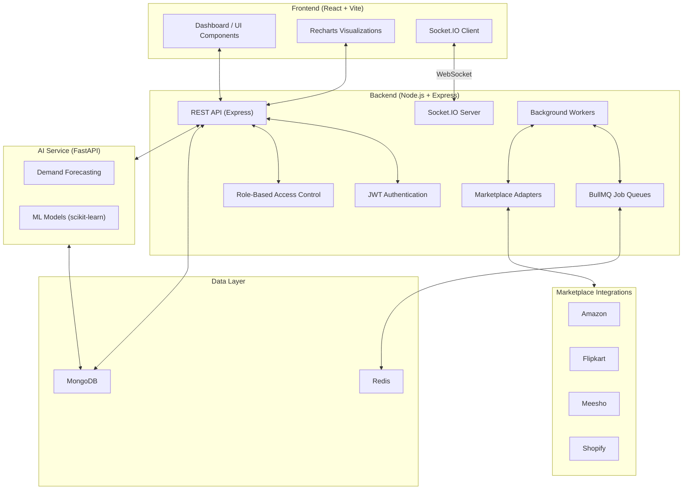

# 🏭 Centralized Multi-Warehouse Inventory Management System (CIMS)

> A full-stack, real-time inventory management platform for businesses operating across multiple warehouses and online marketplaces.

## 📖 Description

**CIMS** is a comprehensive, centralized inventory management system designed to help businesses efficiently manage stock across multiple warehouse locations. It provides real-time tracking of inventory levels, automated order processing, and seamless integration with popular e-commerce marketplaces such as Amazon, Flipkart, Meesho, and Shopify.

The platform features an intelligent AI-powered demand forecasting module that analyzes historical sales data to predict future inventory needs, helping businesses optimize stock levels and reduce both overstock and stockout scenarios. Built with a modern microservices-inspired architecture, CIMS ensures scalability and maintainability as your business grows.

With role-based access control (Admin, Manager, Staff), real-time notifications via WebSockets, background job processing through BullMQ, and a responsive React dashboard with rich data visualizations, CIMS delivers an enterprise-grade experience for inventory operations of any scale.

---

## 🏗️ Architecture



---

## 🛠️ Tech Stack

| Layer              | Technology                                      |
| ------------------ | ----------------------------------------------- |
| **Frontend**       | React 18, Vite, Tailwind CSS, Recharts          |
| **Backend**        | Node.js, Express.js                             |
| **Database**       | MongoDB (Mongoose ODM)                          |
| **Caching/Queues** | Redis, BullMQ                                   |
| **Auth**           | JWT (Access + Refresh Tokens), bcrypt            |
| **Real-time**      | Socket.IO                                       |
| **File Storage**   | Cloudinary                                      |
| **AI Service**     | Python, FastAPI, scikit-learn, pandas, NumPy     |
| **Containers**     | Docker, Docker Compose                          |
| **Marketplace**    | Amazon, Flipkart, Meesho, Shopify (Adapters)    |

---

## ✨ Features

- **Multi-Warehouse Management** — Create, update, and monitor inventory across multiple warehouse locations
- **Real-Time Dashboard** — Live stats, low-stock alerts, recent orders, and visual analytics
- **Role-Based Access Control** — Admin, Manager, and Staff roles with granular permissions
- **Product Management** — Full CRUD with image uploads (Cloudinary), categorization, and search
- **Order Processing** — Create, track, and manage orders with status workflows
- **Inventory Transfers** — Transfer stock between warehouses with audit trails
- **Marketplace Integration** — Sync inventory with Amazon, Flipkart, Meesho, and Shopify
- **AI Demand Forecasting** — Predict future demand using ML models trained on sales history
- **Background Job Processing** — Async marketplace sync and bulk operations via BullMQ
- **Real-Time Notifications** — WebSocket-powered alerts for low stock, order updates, and sync events
- **Responsive UI** — Modern, mobile-friendly interface with dark sidebar and data visualizations

---

## 🚀 Getting Started

### Prerequisites

- **Node.js** v18+ and **npm**
- **Python** 3.11+
- **MongoDB** (local or Atlas)
- **Redis** (local or cloud)
- **Docker & Docker Compose** (optional, for containerized services)

### Clone the Repository

```bash
git clone https://github.com/your-username/cims.git
cd cims
```

### Environment Setup

```bash
cp .env.example .env
# Edit .env with your actual credentials
```

### Install Dependencies

```bash
# Backend
cd backend
npm install

# Frontend
cd ../frontend
npm install

# AI Service
cd ../ai-service
pip install -r requirements.txt
```

### Run with Docker (Redis + MongoDB + AI Service)

```bash
cd infrastructure
docker-compose up -d
```

### Start the Application

```bash
# Terminal 1 — Backend
cd backend
npm run dev

# Terminal 2 — Frontend
cd frontend
npm run dev

# Terminal 3 — AI Service (if not using Docker)
cd ai-service
uvicorn app.main:app --reload --port 8000
```

The frontend will be available at **http://localhost:5173** and the API at **http://localhost:5000**.

---

## 📁 Project Structure

```
CIMS/
├── backend/                  # Node.js + Express API
│   ├── src/
│   │   ├── config/           # DB, Redis, Cloudinary, Socket.IO config
│   │   ├── models/           # Mongoose models
│   │   ├── controllers/      # Route handlers
│   │   ├── routes/           # API route definitions
│   │   ├── middleware/       # Auth, RBAC, error handling
│   │   ├── services/         # Business logic
│   │   ├── adapters/         # Marketplace adapters
│   │   ├── queues/           # BullMQ queue definitions
│   │   ├── workers/          # Background job workers
│   │   ├── utils/            # Helpers and constants
│   │   ├── app.js            # Express app setup
│   │   └── server.js         # Server entry point
│   └── tests/                # Jest test suites
│
├── frontend/                 # React + Vite SPA
│   └── src/
│       ├── components/       # Reusable UI components
│       ├── pages/            # Page-level components
│       ├── layouts/          # Layout wrappers
│       ├── context/          # React Context providers
│       ├── hooks/            # Custom hooks
│       ├── services/         # API service layer
│       ├── routes/           # Router configuration
│       └── utils/            # Utility functions
│
├── ai-service/               # Python FastAPI ML service
│   └── app/
│       ├── forecasting/      # Forecast models and routes
│       └── services/         # Data fetching and preprocessing
│
├── infrastructure/           # Docker Compose for services
│   └── docker-compose.yml
│
├── .env.example              # Environment variable template
├── .gitignore
└── README.md
```

---

## 📡 API Overview

### Authentication
| Method | Endpoint               | Description          |
| ------ | ---------------------- | -------------------- |
| POST   | `/api/v1/auth/register`| Register a new user  |
| POST   | `/api/v1/auth/login`   | Login and get tokens |
| POST   | `/api/v1/auth/refresh` | Refresh access token |
| POST   | `/api/v1/auth/logout`  | Logout               |

### Products
| Method | Endpoint               | Description           |
| ------ | ---------------------- | --------------------- |
| GET    | `/api/v1/products`     | List all products     |
| POST   | `/api/v1/products`     | Create a product      |
| GET    | `/api/v1/products/:id` | Get product details   |
| PUT    | `/api/v1/products/:id` | Update a product      |
| DELETE | `/api/v1/products/:id` | Delete a product      |

### Inventory
| Method | Endpoint                     | Description              |
| ------ | ---------------------------- | ------------------------ |
| GET    | `/api/v1/inventory`          | List inventory records   |
| POST   | `/api/v1/inventory/transfer` | Transfer between warehouses |
| GET    | `/api/v1/inventory/low-stock`| Get low-stock alerts     |

### Orders
| Method | Endpoint               | Description          |
| ------ | ---------------------- | -------------------- |
| GET    | `/api/v1/orders`       | List all orders      |
| POST   | `/api/v1/orders`       | Create an order      |
| PATCH  | `/api/v1/orders/:id`   | Update order status  |

### AI Forecasting
| Method | Endpoint              | Description              |
| ------ | --------------------- | ------------------------ |
| GET    | `/forecast/health`    | Health check             |
| GET    | `/forecast/model-info`| Model metadata           |
| POST   | `/forecast/train`     | Train forecasting model  |
| POST   | `/forecast/predict`   | Get demand predictions   |

---

## 🔑 Demo Credentials (Seeded)

| Role | Email | Password | Assigned Scope |
| ---- | ----- | -------- | -------------- |
| **Super Admin** | `admin@cims.com` | `Admin@123` | Full access across all modules & settings |
| **Inventory Manager** | `inventory@cims.com` | `Admin@123` | Global stock, transfers, and catalog |
| **Delhi Warehouse Manager** | `warehouse.delhi@cims.com` | `Admin@123` | Delhi Northern Hub physical stock |
| **Mumbai Warehouse Manager** | `warehouse.mumbai@cims.com` | `Admin@123` | Mumbai Western Hub physical stock |
| **Sales Manager** | `sales@cims.com` | `Admin@123` | Orders, revenue analytics, and stock |

> ⚠️ These are placeholder credentials for development only. Change them before deploying to production.

---

## 📄 License

This project is licensed under the **MIT License** — see the [LICENSE](LICENSE) file for details.
